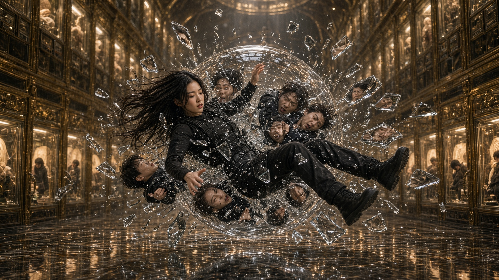
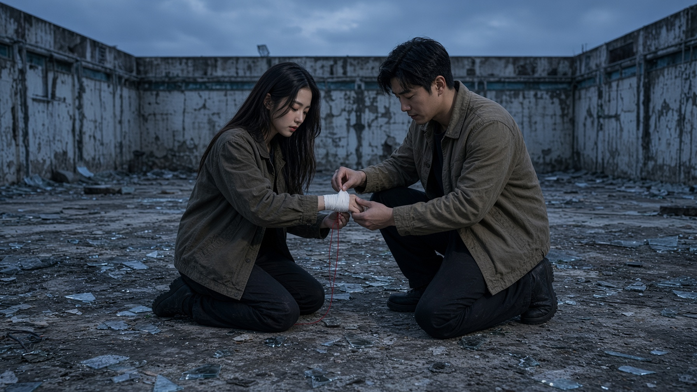
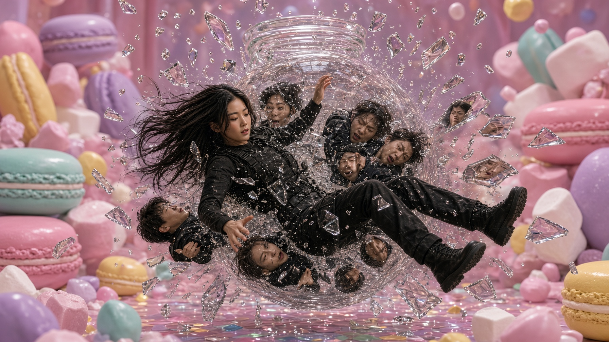
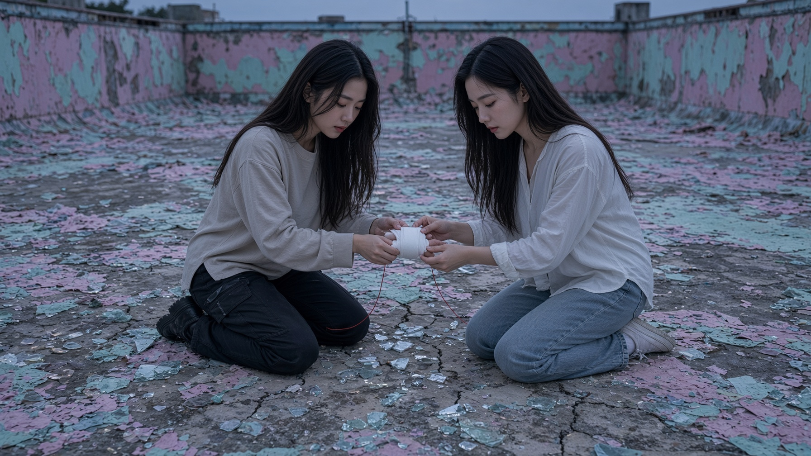

# 《邊界行人》IMAGE 圖庫（證據包）

本目錄把 **I-20 寫實** 與 **I-21 粉彩** 六幕實際生成靜幀回填文檔，方便在 GitHub 直接預覽。  
對應 Prompt 仍在 [`../IMAGE_VIDEO_PROMPT_CATALOG.md`](../IMAGE_VIDEO_PROMPT_CATALOG.md)。

| 欄位 | 值 |
| --- | --- |
| ASOF | 2026-10-24 |
| 證據級別 | `IMAGE_GENERATED_IN_SESSION` |
| `PIXEL_AUDIT_PASS` | **否**（非正式像素驗收） |
| 武器接觸 | **無**（敘事線刻意不硬塞槌／種植圓柱） |

角色身份鎖：`ref/heroine_face_reference.jpg`（僅 identity，非成品鏡）。

完整 SHA 清單見 [`MANIFEST.json`](MANIFEST.json)。

---

## I-20｜寫實電影版

### ACT 1 — 畫界

### ACT 2 — 保護

### ACT 3 — 碎裂

### ACT 4 — 假修

### ACT 5 — 一界

### ACT 6 — 選擇

---

## I-21｜粉彩 INS 版

### ACT 1 — 粉彩亂房畫界

### ACT 2 — 甜點玻璃罩保護

### ACT 3 — 鑽石雨碎裂

### ACT 4 — 抓娃娃機假修

### ACT 5 — 濾鏡消退一界

### ACT 6 — 溜冰天台選擇

---

## 使用方式

1. 文檔閱讀：本 README 直接預覽。  
2. 生成：複製總庫對應 ACT 的完整英文 Prompt，附上 `ref/heroine_face_reference.jpg`。  
3. 影片：V-09 路線以本靜幀作母圖 image-to-video，再拼接；**勿**把本圖庫當成武器幾何 PASS。

---

## 公式源代乘出包（26 鏡）

把 `槌2.txt` 的 `MV_*` 鏡頭包 **串進六幕** 之後的完整靜幀：

- 矩陣與預覽：[`mv26/README.md`](mv26/README.md)
- 清單：[`mv26/MANIFEST.json`](mv26/MANIFEST.json)

| 算法 | 結果 |
| --- | --- |
| 6 幕 × ~4 鏡（ACT3=6） | **26** 張 |
| S4「24 卡」 | ACT3 只留 PACK_IMPACT_4 |
| 再 × 粉彩 I-21 | 未跑（可再乘） |

